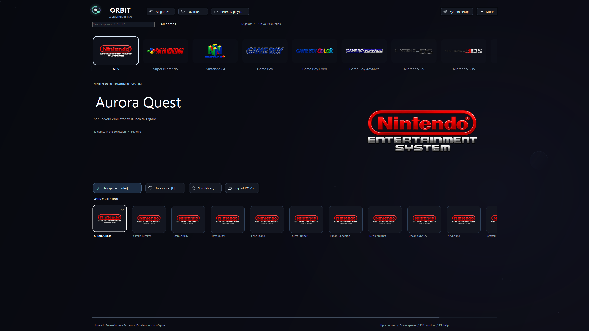

# Orbit Library

A Windows and macOS emulator frontend with a dark space theme, transparent
console logos, fullscreen navigation, and a three-second animated Orbit intro.

| Platform | Download | Requirements |
| --- | --- | --- |
| Windows | [Windows ZIP](https://github.com/themostonoon/orbit-library/releases/latest/download/OrbitLibrary-Windows.zip) | Windows 10/11, .NET Framework 4.8 |
| Mac | [Mac ZIP](https://github.com/themostonoon/orbit-library/releases/latest/download/OrbitLibrary-Mac.zip) | macOS 13+, Apple Silicon or Intel |

## Windows: start playing

1. Download the Windows ZIP from Releases and extract the entire folder.
2. Run `OrbitLibrary.exe` on Windows 10/11 with .NET Framework 4.8 enabled.
3. Open **System setup** and choose a system, ROM folder, and emulator EXE.
4. Save the setup, scan your library, select a game, and press Enter.

This frontend launches your existing emulators. Games, BIOS, firmware, cores,
and emulators are not included. The executable is unsigned.

## Features

- 29 configurable console, handheld, arcade, and DOS system presets.
- Standalone emulator commands and RetroArch core launches.
- Search, favorites, play history, local cover artwork, and folder import.
- A virtualized gallery and background scans/artwork decoding.
- Cached stars and planets, smooth selection easing, and XInput navigation.
- Fullscreen startup; F11 switches back to a window.
- Portable settings and library data stored in `data/library.json`.

Keep the full application folder together. Your library remains local;
the repository and release contain no personal library data or game files.
The preview uses fictional demonstration titles.

## Mac: start playing

1. Download and extract the Mac ZIP, then move **Orbit Library.app** to Applications.
2. Open the app. Configure a **Mac emulator .app or executable** in System setup.
3. Choose your ROM folders, save the setup, and scan your collection.

The Mac app has the same dark space design, 29 system presets, three-second intro,
fullscreen startup, horizontal console/game navigation, search, favorites, recent
games, local covers, and background folder scanning. It uses native SwiftUI/AppKit,
a lazy gallery, background image decoding, and macOS Game Controller input.
The universal app contains native arm64 and x86_64 code and requires no extra runtime.

Mac RetroArch uses **.dylib** cores; Windows .exe/.dll files are not Mac emulators.
Mac settings live in `~/Library/Application Support/OrbitLibrary/library.json` so
updating or moving the app preserves the library. More > Export/Import library JSON
uses the Windows-compatible field format; assign Mac paths and emulators after a move.

The Mac app is ad-hoc signed and not Apple-notarized. If macOS blocks its first
launch, approve the app in **System Settings > Privacy & Security > Open Anyway**.
See [Mac setup instructions](macos/START-HERE-MAC.txt).

## Controls

| Input | Action |
| --- | --- |
| Up / Down | Focus consoles / games |
| Left / Right | Move selection |
| Enter | Confirm a console or launch a game |
| F | Toggle favorite |
| Ctrl+K (Windows) / Command-K (Mac) | Search |
| F11 (or Control-Command-F on Mac) | Toggle fullscreen |
| F1 | Help |
| XInput D-pad / left stick | Navigate |
| A / X | Confirm or launch / favorite |
| LB / RB | Switch category or system |

## Build Windows from source

Run `build.cmd` on Windows. It uses the Windows .NET Framework C# compiler
and requires no package restore, Node.js, or Python. Keep `assets/` and
`orbit.ico` beside the resulting executable.

Run `OrbitLibrary.exe --self-test` for the built-in validation suite.
The `validation/` folder includes additional benchmark and stress-test sources.

See [START-HERE.txt](START-HERE.txt) for launch arguments and setup details,
and [PERFORMANCE.md](PERFORMANCE.md) for local before/after measurements.
The virtual gallery was stress-tested with 10,000 synthetic entries;
real emulator/game performance and physical controller feel were not measured.

## Build Mac from source

On a Mac with Xcode Command Line Tools, run `bash macos/build.sh`. The script builds
both Apple Silicon and Intel binaries, combines them into a universal .app, embeds
the console assets and icon, applies an ad-hoc signature, and creates the release ZIP.
Run `"build/macos/Orbit Library.app/Contents/MacOS/OrbitLibrary" --self-test` for the
Mac validation suite. `--smoke-test output-folder` exercises fullscreen startup and
renders a 10,000-game gallery. The release workflow validates the package on native
Apple Silicon and Intel macOS runners before uploading it to the release.

These checks cover native builds, data handling, launch commands, and UI rendering.
Actual game compatibility and physical controller behavior depend on your Mac emulator.

## Artwork

Console logo images were generated with the built-in image generator and
retain transparent alpha. Prompts are in `assets/GENERATION-PROMPTS.json`.
Console names and marks identify their systems and belong to their respective
owners. Orbit Library is an original frontend and is not affiliated with
console manufacturers, Cocoon, or ES-DE.
